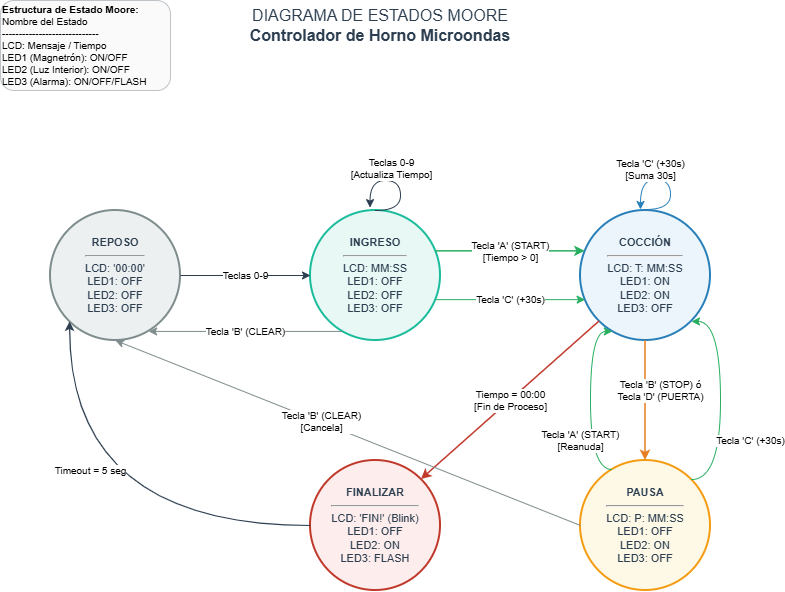

# 📍 TP2: Controlador de Horno Microondas Doméstico

## 📌 Descripción del Proyecto
Desarrollo del firmware del controlador para un horno a microondas doméstico. El sistema permite al usuario configurar el tiempo de cocción, iniciar el proceso, pausarlo, cancelarlo y monitorear el estado mediante un display LCD y LEDs actuadores. 

La arquitectura de software se basa en una **Máquina de Estados Finitos (MEF) periódica** ejecutada mediante interrupción de Timer.

---

## 🔄 Arquitectura del Software (MEF)



*Figura 1: Diagrama de transiciones de estado de la MEF.*

---

## 🛠️ Especificaciones de Hardware y Conexiones (Proteus)
1. **Display LCD 16x2:** Conectado para visualización de estado y tiempo.
2. **Teclado Matricial 4x4:** Conectado a los puertos para lectura de entradas de usuario.
3. **Actuadores LED (resistencia calculada para $I_{LED} = 10mA$):**
   - **LED1 (`PB5`):** Magnetrón encendido durante la cocción.
   - **LED2 (`PC4`):** Luz interior encendida durante el proceso.
   - **LED3 (`PC5`):** Alarma indicadora de fin de proceso.

---

## 🎮 Funcionalidad del Teclado y Máquina de Estados
- **Teclas `0-9`:** Ingreso del tiempo de cocción en formato `MM:SS`.
- **Tecla `A` (START):** Inicia la cocción si el tiempo ingresado es mayor a cero.
- **Tecla `B` (STOP/CLEAR):**
  - *Modo ingreso:* Borra el tiempo a `00:00`.
  - *Modo cocción:* Pausa el proceso.
  - *Modo pausa:* Cancela el proceso y vuelve al reposo.
- **Tecla `C` (+30s):** Suma 30 segundos al tiempo actual de cocción.
- **Tecla `D` (PUERTA):** Simula la apertura/cierre de la puerta (pausa la cocción inmediatamente si se abre).
- **Fin de Proceso:** Parpadeo del display LCD durante 5 segundos al finalizar el tiempo antes de regresar al estado de reposo.

---

## 📐 Memoria de Cálculo
- **Cálculo de Resistencias Limitadoras:** La deducción matemática para la limitación de corriente a 10mA según la caída de tensión $V_{LED}$ de cada color está detallada en el documento [Calculo_Resistencias_LEDs.pdf](./docs/Calculo_Resistencias_LEDs.pdf).

---

## 📄 Consigna Oficial y Documentación
- Enunciado oficial: [docs/tp02-2026_entregable.pdf](./docs/tp02-2026_entregable.pdf)
- Imagen del Diagrama de Estados: [docs/img/diagrama_mef.png](./docs/img/diagrama_mef.png)

---

## 📂 Estructura del TP
```text
TP2_Controlador_Microondas/
├── docs/
│   ├── tp02-2026_entregable.pdf    # Consigna oficial de la cátedra
│   └── img/
│       └── diagrama_mef.png        # Diagrama de estados de la MEF
├── MicrochipStudio/                # Proyecto y código fuente en C (AVR-GCC)
├── Proteus/                        # Esquema de simulación (.pdsprj v8.12)
└── README.md                       # Documentación principal del TP
